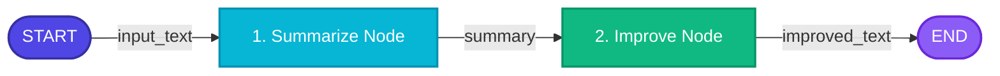

# 01. Sequential AI Workflow

[](https://www.python.org/)
[](https://github.com/langchain-ai/langgraph)
[](https://github.com/langchain-ai/langchain)
[](https://aistudio.google.com/)

A foundational **LangGraph** project demonstrating deterministic, step-by-step linear workflow execution using **Google Gemini** (`gemini-3.7-flash`).

---

## 📌 Overview

The **Sequential AI Workflow** illustrates the core architectural pattern of LangGraph: building stateful pipelines where each processing node takes input from the shared graph state, performs an LLM transformation, updates the state, and passes control to the next node in a predefined sequence.

### 🔄 Workflow Pipeline

In this workflow, raw input text is processed through two sequential stages:
1. **Summarize Node (`summarize`)**: Takes raw text and generates an initial concise summary.
2. **Improve Node (`improve`)**: Takes the summary generated by the previous node, enhances clarity, tone, and professional phrasing, and outputs multiple refined options.

---

## 🏗️ Architecture Flow

### Mermaid Diagram



### ASCII Flow

```text
┌─────────┐      ┌────────────────────┐      ┌──────────────────┐      ┌───────┐
│  START  │ ───► │ 1. Summarize Node  │ ───► │ 2. Improve Node  │ ───► │  END  │
└─────────┘      └────────────────────┘      └──────────────────┘      └───────┘
```

---

## 📊 State Management Schema

The workflow uses Python's `TypedDict` to declare the centralized state structure passed between nodes:

```python
from typing import TypedDict

class WorkflowState(TypedDict):
    input_text: str       # Raw text provided by user
    summary: str          # Intermediate concise summary
    improved_text: str    # Polished and professionally enhanced text
```

### State Progression Lifecycle:
1. **Initial State**: `{"input_text": "..."}`
2. **After `summarize` Node**: `{"input_text": "...", "summary": "..."}`
3. **After `improve` Node**: `{"input_text": "...", "summary": "...", "improved_text": "..."}`

---

## 📁 Project Structure

```text
01_Sequential_AI_Workflow/
│
├── sequential_workflow.ipynb        # Interactive Jupyter notebook walkthrough
├── requirements.txt                 # Project dependencies
├── .env.example                     # Environment variables template
├── .env                             # Local environment variables (API keys)
├── .gitignore                       # Git ignore rules
└── README.md                        # Project documentation
```

---

## 🚀 Getting Started

### 1. Prerequisites
- Python 3.10+
- Google Gemini API Key ([AI Studio](https://aistudio.google.com/))

### 2. Set Up Virtual Environment
```bash
# Windows PowerShell
python -m venv venv
.\venv\Scripts\Activate.ps1

# Linux / macOS
python3 -m venv venv
source venv/bin/activate
```

### 3. Install Dependencies
```bash
pip install -r requirements.txt
```

### 4. Configure Environment Variables
Copy `.env.example` to `.env` and add your Google Gemini API key:
```bash
cp .env.example .env
```

Inside `.env`:
```env
GOOGLE_API_KEY=your_gemini_api_key_here
```

### 5. Run the Notebook
```bash
jupyter notebook sequential_workflow.ipynb
```

---

## 💡 Key LangGraph Concepts Explored

* **`StateGraph`**: Creating and configuring the workflow graph.
* **Nodes as Functions**: Building pure, isolated transformation functions receiving `state: WorkflowState`.
* **Static Edges (`add_edge`)**: Defining deterministic transitions (`START -> summarize -> improve -> END`).
* **Graph Compilation (`compile()`)**: Converting graph definitions into executable `Runnable` objects.
* **Invocation & Streaming**:
  - `app.invoke(initial_state)`: Execute all nodes to completion.
  - `app.stream(initial_state)`: Inspect state transformations node-by-node in real-time.
* **Graph Visualization**: Generating Mermaid architecture diagrams directly in IPython (`draw_mermaid_png()`).
