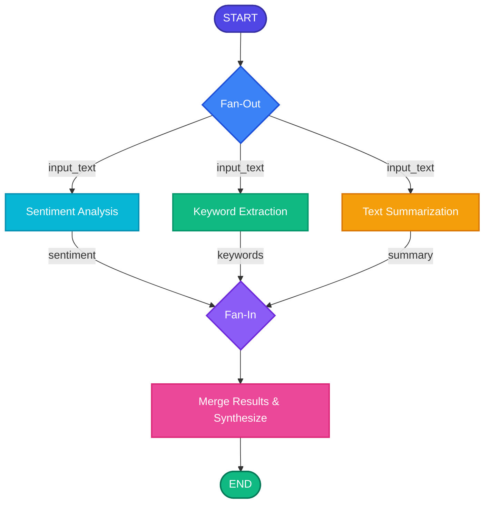

# 03. Parallel Multi-Analysis Workflow

A comprehensive **LangGraph** project demonstrating concurrent multi-agent processing using the **Fan-Out & Fan-In** architecture pattern.

---

## 📌 Overview

The **Parallel Multi-Analysis Workflow** demonstrates how multiple independent AI analysis tasks can execute concurrently on the exact same input and seamlessly aggregate their findings into a unified, high-value final analysis report.

Unlike a traditional sequential pipeline—where each step is blocked waiting for the previous step to finish—this project splits execution across multiple parallel branches:
1. **Sentiment Analysis**: Evaluates tone, emotional polarity, and nuances.
2. **Keyword & Topic Extraction**: Identifies key entities, technical terms, and primary topics.
3. **Executive Summarization**: Distills core points into a concise summary.

Once all three parallel tasks finish, their outputs are routed into a **Merge Node** (Fan-In) that synthesizes a structured executive report.

---

## 🏗️ Workflow Architecture

### Mermaid Diagram



### ASCII Flow

```text
                              START
                                │
                ┌───────────────┼───────────────┐
                │               │               │
                ▼               ▼               ▼
           Sentiment        Keywords         Summary
            Analysis        Extraction        Generation
                │               │               │
                └───────────────┼───────────────┘
                                │
                                ▼
                           Merge Results
                                │
                                ▼
                               END
```

---

## ⚡ Fan-Out & Fan-In Pattern

### 1. Fan-Out (Parallel Dispatch)
When execution reaches a branching point, LangGraph automatically schedules multiple edges from `START` to execute independently:

```text
                Input
                  │
        ┌─────────┼─────────┐
        ▼         ▼         ▼
    Sentiment  Keywords   Summary
```

* **Zero Waiting**: All three nodes receive the initial `input_text` simultaneously.
* **Latency Optimization**: Total analysis latency equals `max(T_sentiment, T_keywords, T_summary)` instead of `T_sentiment + T_keywords + T_summary`.

### 2. Fan-In (Aggregation & Synchronization)
When multiple parallel branches connect into a single downstream node (`merge_results`), LangGraph guarantees synchronization:

```text
Sentiment ───┐
Keywords ────┼────► Merge Results
Summary ────┘
```

* LangGraph manages state concurrency and ensures that the merge node executes only after all preceding parallel nodes have committed their state updates.

---

## 📊 State Management Schema

The state is defined using Python's `TypedDict` and tracks the lifecycle of the analysis:

```python
from typing import TypedDict, List

class ContentAnalysisState(TypedDict):
    input_text: str          # Original content provided by the user
    sentiment: str           # Tone & sentiment breakdown
    keywords: List[str]      # Top keywords and entities extracted
    summary: str             # Concise multi-sentence summary
    final_analysis: str      # Unified synthesis report generated by merge node
```

### State Progression

```text
1. Initial State:
   { "input_text": "..." }

2. After Parallel Processing (Fan-Out):
   {
       "input_text": "...",
       "sentiment": "Positive (Confidence: High)...",
       "keywords": ["AI", "LangGraph", "Concurrency", ...],
       "summary": "This document explores parallel processing in LangGraph..."
   }

3. Final State (Fan-In):
   {
       "input_text": "...",
       "sentiment": "...",
       "keywords": [...],
       "summary": "...",
       "final_analysis": "## Executive Content Report\n..."
   }
```

---

## 📁 Project Structure

```text
03_Parallel_Content_Analyzer/
│
├── parallel_content_analyzer.ipynb  # Main interactive Jupyter Notebook
├── requirements.txt                 # Project dependencies
├── .env.example                     # Environment template
├── .env                             # Local environment variables (API keys)
├── .gitignore                       # Git ignore rules
└── README.md                        # Documentation and architecture guide
```

---

## 🚀 Getting Started

### 1. Clone & Navigate
```bash
cd d:/LangraphProjects/03_Parallel_Content_Analyzer
```

### 2. Set Up Virtual Environment
```bash
python -m venv venv
# On Windows PowerShell:
.\venv\Scripts\Activate.ps1
# On macOS/Linux:
source venv/bin/activate
```

### 3. Install Dependencies
```bash
pip install -r requirements.txt
```

### 4. Configure API Key
Copy `.env.example` to `.env` and add your Google Gemini API key:
```bash
# In .env:
GOOGLE_API_KEY=your_actual_gemini_api_key_here
```

### 5. Launch Jupyter Notebook
```bash
jupyter notebook parallel_content_analyzer.ipynb
```

---

## 💡 Key LangGraph Concepts Explored

* **`StateGraph`**: Initializing and composing a graph with custom state schemas.
* **Shared State (`TypedDict`)**: Managing thread-safe, immutable-style state transformations.
* **Nodes as Specialized Functions**: Pure, decoupled Python functions handling dedicated LLM tasks.
* **Branching & Parallel Edges**: Using multiple `builder.add_edge(START, ...)` calls to achieve Fan-Out.
* **Synchronization Edges**: Directing multiple nodes to a single collector node to achieve Fan-In.
* **Streaming Workflow Execution (`graph.stream()`)**: Observing real-time parallel execution and node completion order.
* **Clean Markdown Rendering**: Presenting clean, structured, and wrap-safe outputs in Jupyter.

---

## 🌐 Real-World Applications

1. **Enterprise Document Ingestion**:
   - Concurrently extract metadata, generate compliance ratings, scan for PII, and generate executive summaries from uploaded PDFs.
2. **Customer Support Ticket Triage**:
   - Simultaneously detect sentiment/urgency, extract product identifiers, identify root issues, and draft response templates.
3. **Financial Earnings Analysis**:
   - Concurrently parse revenue metrics, gauge executive sentiment on calls, detect risk factors, and compile investment summaries.
