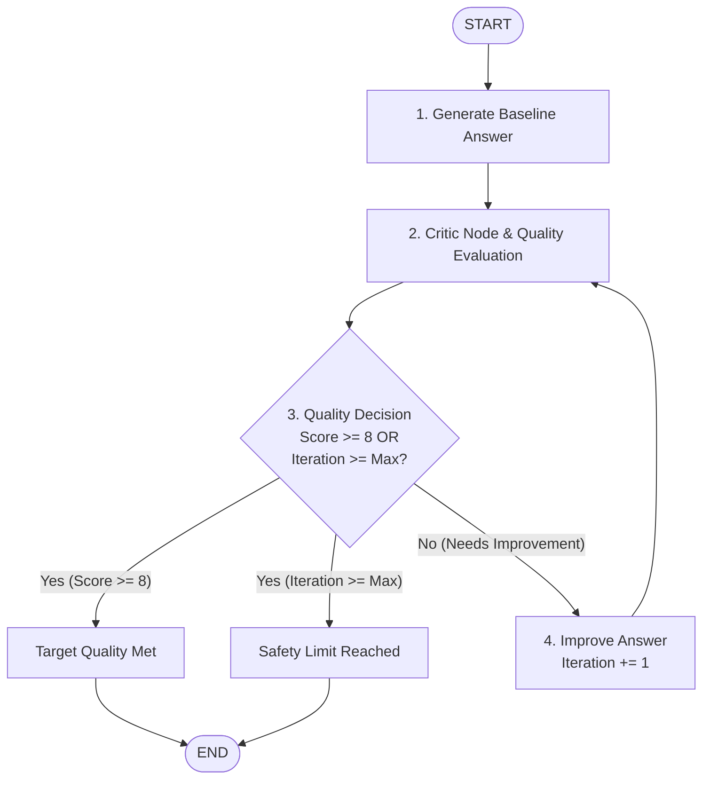

# 04. Iterative AI Answer Improvement Workflow

[](https://www.python.org/)
[](https://github.com/langchain-ai/langgraph)
[](https://github.com/langchain-ai/langchain)
[](https://aistudio.google.com/)

An advanced **LangGraph** project demonstrating **cyclic workflows, reflection patterns, structured critique evaluation, and conditional self-improvement** using **Google Gemini**.

---

## 📌 Table of Contents
- [Overview](#overview)
- [Architecture & Workflow](#architecture--workflow)
- [How It Works](#how-it-works)
- [Key LangGraph Concepts](#key-langgraph-concepts)
- [State Management](#state-management)
- [Loop Termination & Safety](#loop-termination--safety)
- [Project Structure](#project-structure)
- [Installation & Setup](#installation--setup)
- [Usage](#usage)
  - [1. Running the Jupyter Notebook](#1-running-the-jupyter-notebook)
  - [2. Running the CLI Script (`main.py`)](#2-running-the-cli-script-mainpy)
- [Example Execution Walkthrough](#example-execution-walkthrough)
- [Real-World Applications](#real-world-applications)
- [Contributing & License](#contributing--license)

---

## Overview

Unlike traditional sequential chains where each component executes only once:

$$\text{START} \longrightarrow \text{Generate} \longrightarrow \text{Evaluate} \longrightarrow \text{END}$$

real-world AI systems require **iterative refinement loops**. In this workflow, an AI model evaluates its own output, identifies gaps or weaknesses, refines the answer, and loops back to evaluation until the output satisfies a predefined quality threshold.

```text
Generate Answer ──► Evaluate ──► Improve ──► Evaluate Again
```

---

## Architecture & Workflow



### Flow Breakdown:
1. **`generate_answer`**: Generates a baseline draft response to the user's question.
2. **`critic`**: Evaluates the current response against strict quality criteria (Accuracy, Clarity, Depth, Relevance) and produces a structured score (1–10), identified weaknesses, and actionable suggestions.
3. **`route_evaluation`**: Conditional edge function that decides whether the score is high enough (`score >= 8`) or if the workflow should loop back.
4. **`improve_answer`**: Synthesizes the previous answer, identified weaknesses, and critic feedback into a polished draft, increments the iteration counter, and routes back to the critic.

---

## How It Works

### Example Question:
> *"Explain why Retrieval-Augmented Generation (RAG) is useful in AI applications."*

| Step | Node | Action | Score |
| :--- | :--- | :--- | :---: |
| **0** | `generate_answer` | Creates an initial concise answer about RAG. | - |
| **1** | `critic` | Analyzes baseline draft. Flags missing details about dynamic retrieval, grounding, and hallucination reduction. | **6/10** |
| **2** | `improve_answer` | Revises explanation by detailing embedding search, vector databases, and real-time knowledge grounding. | - |
| **3** | `critic` | Re-evaluates revised answer. Confirms high clarity, technical accuracy, and structured formatting. | **9/10** |
| **4** | `route_evaluation` | Quality threshold satisfied ($9 \ge 8$). Routes to `END`. | **9/10** |

---

## Key LangGraph Concepts

* **`StateGraph`**: Builds a stateful graph where nodes modify a shared state dictionary.
* **Cyclic Edges / Loops**: Routes execution back to previously executed nodes (`improve_answer -> critic`).
* **Conditional Edges**: Dynamic routing decisions based on runtime state values (`score` and `iteration`).
* **Reflection & Critic Pattern**: Decoupling the generator and evaluator roles to eliminate evaluation bias.
* **Structured Outputs**: Integrating Pydantic models with `llm.with_structured_output(CritiqueOutput)` for reliable, typed schema evaluation.
* **Streaming Execution**: Real-time inspection of node-by-node state transitions using `.stream()`.

---

## State Management

The workflow passes a typed state dictionary across all nodes:

```python
class WorkflowState(TypedDict):
    question: str              # User query
    answer: str                # Current draft or improved response
    critique: str              # Actionable feedback from the critic
    score: int                 # Quality score (1-10)
    strengths: List[str]       # Identified positive aspects
    weaknesses: List[str]      # Identified missing details or issues
    iteration: int             # Current iteration count (starts at 0)
    max_iterations: int        # Hard upper limit (e.g., 3)
    target_score: int          # Acceptance threshold (e.g., 8)
    history: List[Dict]        # Audit trail of all iterations
```

### State Progression Example:

```json
// Initial State
{
  "question": "What is RAG?",
  "iteration": 0,
  "max_iterations": 3,
  "target_score": 8
}

// After Node 1: generate_answer
{
  "question": "What is RAG?",
  "answer": "RAG is a technique that combines search with LLMs...",
  "iteration": 0
}

// After Node 2: critic
{
  "question": "What is RAG?",
  "answer": "RAG is a technique...",
  "score": 6,
  "weaknesses": ["Lacks mention of vector databases and hallucinations."],
  "critique": "Explain vector embeddings and how RAG reduces hallucinations.",
  "iteration": 0
}

// After Node 3: improve_answer
{
  "question": "What is RAG?",
  "answer": "Retrieval-Augmented Generation (RAG) enhances LLMs by...",
  "iteration": 1
}
```

---

## Loop Termination & Safety

Without strict termination boundaries, iterative AI loops can execute infinitely if the model cannot satisfy the critic:

```text
Critic ──► Improve ──► Critic ──► Improve ──► (Infinite Loop)
```

To prevent runaway token usage and latency, the routing function enforces **dual termination conditions**:

$$\text{Terminate if } (\text{Score} \ge \text{Target Score}) \lor (\text{Iteration} \ge \text{Max Iterations})$$

```python
def route_evaluation(state: WorkflowState) -> str:
    if state["score"] >= state["target_score"]:
        return "good_enough"      # -> END
    elif state["iteration"] >= state["max_iterations"]:
        return "max_reached"      # -> END
    else:
        return "needs_improvement" # -> improve_answer
```

---

## Project Structure

```text
04_Iterative_Answer_Improvement/
│
├── iterative_answer_improvement.ipynb   # Interactive Jupyter Notebook
├── main.py                              # Standalone CLI execution script
├── requirements.txt                     # Project dependencies
├── .env.example                         # Environment template
├── .env                                 # Local environment file (with API key)
└── README.md                            # Complete documentation
```

---

## Installation & Setup

### 1. Clone or Navigate to Directory
```bash
cd 04_Iterative_Answer_Improvement
```

### 2. Create and Activate Virtual Environment
```bash
# Windows
python -m venv venv
.\venv\Scripts\activate

# Linux / macOS
python3 -m venv venv
source venv/bin/activate
```

### 3. Install Dependencies
```bash
pip install -r requirements.txt
```

### 4. Configure Google Gemini API Key
Get your free API key from [Google AI Studio](https://aistudio.google.com/).

Create a `.env` file from the template:
```bash
# Windows
copy .env.example .env

# Linux / macOS
cp .env.example .env
```

Edit `.env`:
```ini
GOOGLE_API_KEY=your_actual_gemini_api_key_here
GEMINI_MODEL=gemini-2.5-flash
```

---

## Usage

### 1. Running the Jupyter Notebook
Start Jupyter Notebook or JupyterLab:
```bash
jupyter notebook iterative_answer_improvement.ipynb
```
Follow the interactive step-by-step cells with visual graphs, execution streams, and score comparisons.

### 2. Running the CLI Script (`main.py`)
Run the workflow directly from your terminal:

```bash
# Default technical prompt
python main.py

# Custom question with custom quality threshold
python main.py -q "Explain the difference between Monolithic and Microservices architecture." -t 9 -m 4
```

#### CLI Options:
* `-q`, `--question`: The question to answer and iteratively refine (string).
* `-t`, `--target-score`: Quality threshold between 1 and 10 to exit the loop (default: `8`).
* `-m`, `--max-iterations`: Max improvement cycles allowed (default: `3`).

---

## Example Execution Walkthrough

```text
======================================================================
 LangGraph Iterative AI Answer Improvement Workflow
======================================================================

User Question: Explain why Retrieval-Augmented Generation (RAG) is useful in AI applications.
Settings: Target Score = 8/10 | Max Iterations = 3

[Node 1: Generate Answer] (Iteration 0)
Baseline answer generated (concise definition).

[Node 2: Critic Evaluation] (Iteration 0)
Quality Score: 6/10 (Target: 8/10)
Strengths: Accurately identifies RAG as combining retrieval and generation.
Weaknesses: Does not mention vector search, hallucination reduction, or private enterprise data.
Critique: Detail how external knowledge bases prevent hallucination and support private data.

[Routing Decision] Score (6/8) below target. Routing to improve_answer.

[Node 3: Improve Answer] (Iteration 1)
Refined answer incorporating vector embeddings, grounding, and cost benefits.

[Node 2: Critic Evaluation] (Iteration 1)
Quality Score: 9/10 (Target: 8/10)
Strengths: Comprehensive, well-structured with clear bullet points, technically thorough.
Weaknesses: None significant.
Critique: Excellent and complete explanation.

[Routing Decision] Target score reached (9/8)! Routing to END.

🎯 Final Result: Score 9/10 | Total Iterations: 1
```

---

## Real-World Applications

The iterative loop pattern is the foundation for numerous production agent architectures:

| Application Pattern | Generation Node | Evaluation / Critic Node | Action on Failure |
| :--- | :--- | :--- | :--- |
| **Self-Correcting RAG** | Retrieve documents | Assess relevance & context sufficiency | Rewrite query and re-retrieve |
| **AI Writing Assistant** | Draft section | Review tone, grammar, and guidelines | Rewrite with targeted feedback |
| **Autonomous Research** | Search & summarize | Evaluate completeness of evidence | Formulate follow-up search queries |
| **Code Generation** | Write Python script | Run unit tests & static analysis | Provide traceback to generator to fix code |

---

## Contributing & License

This project is part of the LangGraph Learning Series. Contributions, issues, and feature suggestions are welcome!
Licensed under the [MIT License](LICENSE).
