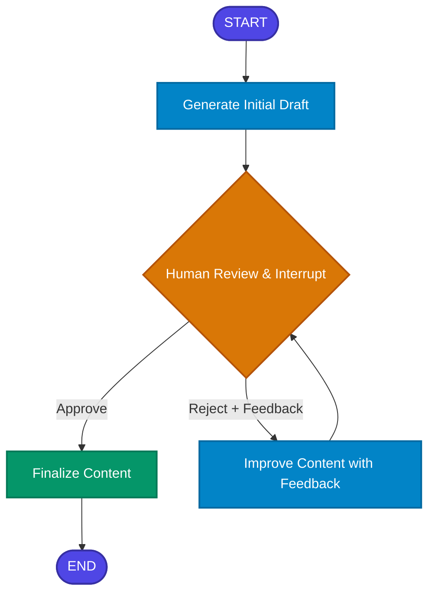

# 05. Human-in-the-Loop Approval Workflow

[](https://www.python.org/)
[](https://github.com/langchain-ai/langgraph)
[](https://github.com/langchain-ai/langchain)
[](https://aistudio.google.com/)

A comprehensive **LangGraph** project demonstrating how to design and build **Human-in-the-Loop (HITL)** AI architectures with workflow interruption, state checkpointing, iterative human review, and dynamic execution resumption using **Google Gemini**.

---

## 📌 Table of Contents
- [Overview](#overview)
- [Architecture & Workflow](#architecture--workflow)
- [How It Works](#how-it-works)
- [Core LangGraph Concepts](#core-langgraph-concepts)
  - [1. Workflow Interruption (`interrupt`)](#1-workflow-interruption-interrupt)
  - [2. State Checkpointing (`MemorySaver`)](#2-state-checkpointing-memorysaver)
  - [3. Resumption via `Command(resume=...)`](#3-resumption-via-commandresume)
- [State Management & Lifecycle](#state-management--lifecycle)
- [Project Structure](#project-structure)
- [Installation & Setup](#installation--setup)
- [Usage](#usage)
  - [1. Interactive CLI (`main.py`)](#1-interactive-cli-mainpy)
  - [2. Jupyter Notebook (`human_in_the_loop_workflow.ipynb`)](#2-jupyter-notebook-human_in_the_loop_workflowipynb)
  - [3. Automated Simulation / Test Mode](#3-automated-simulation--test-mode)
- [Example Execution Walkthrough](#example-execution-walkthrough)
- [Autonomous vs. Human-in-the-Loop Comparison](#autonomous-vs-human-in-the-loop-comparison)
- [Real-World Enterprise Applications](#real-world-enterprise-applications)
- [License](#license)

---

## Overview

In mission-critical enterprise systems, AI agents should rarely operate completely unchecked. Unsupervised generation poses risks of factual errors, misaligned brand tone, unintended side-effects, or regulatory compliance breaches.

The **Human-in-the-Loop (HITL) Approval Workflow** bridges automated AI efficiency and human domain expertise:

$$\text{AI Automation (Speed, Scale, Synthesis)} \quad + \quad \text{Human Review (Judgment, Safety, Nuance)}$$

Instead of executing linearly from `START` to `END`, the graph generates content, **suspends execution at a designated checkpoint**, presents the output for human inspection, and waits for a decision:
- **Approval**: Finalizes the content and concludes the workflow.
- **Rejection**: Collects human feedback, routes back to an AI refinement node, and re-presents the improved draft for review.

---

## Architecture & Workflow

```text
                              START
                                │
                                ▼
                        Generate Content
                                │
                                ▼
                      Human Review (PAUSE)
                                │
                    ┌───────────┴───────────┐
                    │                       │
                    ▼                       ▼
                 Approve                  Reject
                    │                       │
                    ▼                       ▼
              Finalize Content       Improve Content
                    │                       │
                    │                       │
                    ▼                       │
                   END                      │
                                            ▼
                                   Human Review (PAUSE)
```

### Flow Representation



---

## How It Works

### 1. Generate Content
The user provides a topic or directive (e.g., *"Write a professional LinkedIn post about the importance of AI agents"*). The `generate_content` node prompts Google Gemini to create a structured draft.

### 2. Pause for Human Review
The graph enters the `human_review` node and executes `interrupt(...)`. LangGraph halts graph execution, saves the complete thread state to the checkpointer, and yields control back to the caller.

### 3. Human Decision
The reviewer inspects the draft and selects an action:
- **Approve**: Confirms the draft meets standards.
- **Reject with Feedback**: Provides specific guidance (e.g., *"Make it shorter, more punchy, and highlight enterprise ROI"*).
- **Manual Edit**: Directly edits the draft and submits.

### 4. Improve Content (Iterative Loop)
If rejected, the graph routes to `improve_content`. The AI receives:
- Original topic/prompt
- Previous draft
- Human reviewer's feedback notes

The revised draft is stored in state, and execution loops back to `human_review` for another round of evaluation.

### 5. Finalize Content
Upon approval, `finalize_content` sets the approved payload as `final_content`, records the audit history, and terminates at `END`.

---

## Core LangGraph Concepts

### 1. Workflow Interruption (`interrupt`)
Modern LangGraph (v1.2+) provides the native `interrupt()` function. When called inside a node:
```python
from langgraph.types import interrupt

def human_review(state: ContentState):
    # Workflow stops here and surfaces the dictionary payload
    decision = interrupt({
        "message": "Review required",
        "draft": state["generated_content"],
        "iteration": state["iteration_count"]
    })
    
    # When resumed, 'decision' contains the payload passed into Command(resume=...)
    return {
        "approval_status": decision.get("action"),
        "human_feedback": decision.get("feedback")
    }
```

### 2. State Checkpointing (`MemorySaver`)
For a graph to pause and resume asynchronously (even across minutes, hours, or server restarts), state must be persisted.
```python
from langgraph.checkpoint.memory import MemorySaver

checkpointer = MemorySaver()
app = workflow.compile(checkpointer=checkpointer)
```
Every invocation is partitioned by a `thread_id` in the config:
```python
config = {"configurable": {"thread_id": "session-101"}}
```

### 3. Resumption via `Command(resume=...)`
To wake up an interrupted graph and deliver external input back to the paused node:
```python
from langgraph.types import Command

# Resuming with human rejection + critique
app.stream(
    Command(resume={"action": "reject", "feedback": "Add more technical details."}),
    config=config
)

# Resuming with approval
app.stream(
    Command(resume={"action": "approve"}),
    config=config
)
```

---

## State Management & Lifecycle

The shared state schema `ContentState` tracks the draft throughout its revision cycle:

```python
class ContentState(TypedDict):
    topic: str
    generated_content: str
    approval_status: Optional[str]  # 'approved' | 'rejected' | 'pending'
    human_feedback: Optional[str]
    final_content: Optional[str]
    iteration_count: int
    revision_history: List[Dict[str, Any]]
```

### State Evolution Matrix

| Stage | `iteration_count` | `generated_content` | `approval_status` | `human_feedback` | `final_content` |
| :--- | :---: | :--- | :---: | :--- | :--- |
| **Initial Input** | `0` | `None` | `None` | `None` | `None` |
| **After Generation** | `1` | `Draft v1 (AI)` | `'pending'` | `None` | `None` |
| **Human Rejection** | `1` | `Draft v1 (AI)` | `'reject'` | `"Make it shorter..."` | `None` |
| **AI Improvement** | `2` | `Draft v2 (Refined)` | `'pending'` | `"Make it shorter..."` | `None` |
| **Human Approval** | `2` | `Draft v2 (Refined)` | `'approve'` | `"Looks great!"` | `Draft v2 (Refined)` |

---

## Project Structure

```text
05_Human_In_The_Loop_Workflow/
│
├── human_in_the_loop_workflow.ipynb   # Interactive step-by-step Jupyter Notebook
├── main.py                            # Interactive Rich CLI application & simulation runner
├── requirements.txt                   # Project dependencies
├── .env.example                       # Environment template for Gemini API
├── .env                               # Local API configuration (git-ignored)
├── .gitignore                         # Git ignore configuration
└── README.md                          # Comprehensive project documentation
```

---

## Installation & Setup

### 1. Clone & Navigate to Project
```bash
cd d:/LangraphProjects/05_Human_In_The_Loop_Workflow
```

### 2. Create and Activate Virtual Environment
```bash
# Windows
python -m venv venv
.\venv\Scripts\activate

# Linux/macOS
python3 -m venv venv
source venv/bin/activate
```

### 3. Install Dependencies
```bash
pip install -r requirements.txt
```

### 4. Configure Environment Variables
Copy `.env.example` to `.env` and add your Google Gemini API key:
```ini
GOOGLE_API_KEY=your_actual_google_api_key_here
GEMINI_MODEL=gemini-2.5-flash
```
*(Get a free API key at [Google AI Studio](https://aistudio.google.com/))*

---

## Usage

### 1. Interactive CLI (`main.py`)
Run the rich terminal interface:
```bash
python main.py
```
Or specify a custom topic directly:
```bash
python main.py --topic "Draft an executive summary on AI safety in enterprise workflows"
```

### 2. Jupyter Notebook (`human_in_the_loop_workflow.ipynb`)
Launch JupyterLab or VSCode Notebook:
```bash
jupyter notebook human_in_the_loop_workflow.ipynb
```
Follow the step-by-step cells to observe interrupts, inspect thread states, and trigger resume commands.

### 3. Automated Simulation / Test Mode
Run the non-interactive automated test suite to verify graph compilation, interruption handling, rejection loops, and final approval:
```bash
python main.py --test
```

---

## Example Execution Walkthrough

```text
🤖 LangGraph Human-in-the-Loop Approval Workflow
Topic: Write a professional LinkedIn post about the importance of AI agents.

⚡ Phase 1: Initiating Content Generation...
[Node: generate_content] Generating initial draft for: 'Write a professional LinkedIn post...'

┏━━━━━━━━━━━━━━━━ Human Review Required — Draft (Iteration 1) ━━━━━━━━━━━━━━━━┓
┃ 🚀 The Future of AI Agents: Why It Matters Today                            ┃
┃                                                                              ┃
┃ In today's fast-evolving technological landscape, AI agents are shifting...  ┃
┃ • Autonomous Execution: Multi-step goal oriented reasoning                   ┃
┃ • Human-AI Synergy: Pairing automated speed with human oversight            ┃
┃                                                                              ┃
┃ 💡 What are your thoughts? Share below!                                      ┃
┗━━━━━━━━━━━━━━━━━━━━━━━━━━━━━━━━━━━━━━━━━━━━━━━━━━━━━━━━━━━━━━━━━━━━━━━━━━━━━━┛

Reviewer Options:
  [1] Approve and Finalize Content
  [2] Reject and Request AI Revision (with Feedback)
  [3] Edit Draft Manually and Approve
  [4] Cancel & Exit Workflow

Select an action: 2
💬 Enter your feedback for the AI: Make it shorter and focus specifically on ROI for engineering teams.

🔄 Rejection submitted. Resuming workflow to improve draft...
[Node: improve_content] Improving draft based on feedback...

┏━━━━━━━━━━━━━━━━ Human Review Required — Draft (Iteration 2) ━━━━━━━━━━━━━━━━┓
┃ ✨ [Refined Iteration 2] AI Agents in Engineering Workflows                  ┃
┃                                                                              ┃
┃ Addressing Reviewer Notes: "Make it shorter and focus specifically on ROI..."┃
┃ Core Takeaways:                                                              ┃
┃ 1. Direct Engineering ROI: 40% reduction in manual boilerplate verification. ┃
┃ 2. Controlled Guardrails: Predictable human checkpoints eliminate risk.      ┃
┗━━━━━━━━━━━━━━━━━━━━━━━━━━━━━━━━━━━━━━━━━━━━━━━━━━━━━━━━━━━━━━━━━━━━━━━━━━━━━━┛

Select an action: 1
✅ Approved! Resuming workflow to finalize...

🎉 FINAL APPROVED CONTENT:
Workflow Completed: True
Total Iterations: 2
```

---

## Autonomous vs. Human-in-the-Loop Comparison

| Feature | Fully Autonomous Workflows | Human-in-the-Loop (HITL) Workflows |
| :--- | :--- | :--- |
| **Execution Model** | Uninterrupted `START` $\to$ `END` | Pauses at critical nodes via `interrupt()` |
| **Risk Profile** | High risk of unchecked hallucination or errors | Low risk; human confirms before execution |
| **State Persistence** | Transient memory during run | Persistent Checkpointing (`MemorySaver` / DB) |
| **Feedback Handling** | Model self-evaluates (may miss domain nuances) | Human provides explicit domain feedback |
| **Use Cases** | Low-risk batch summarization, classification | Publishing, financial trades, legal drafts, medical triage |

---

## Real-World Enterprise Applications

1. **AI Content Publishing & Marketing**: Editorial review gates before publishing blog articles or social campaigns.
2. **Customer Support Escalation**: AI drafts email/ticket responses for high-tier accounts, requiring agent sign-off before dispatch.
3. **Legal & Compliance Contracts**: AI parses contract clauses and redlines documents; legal counsel approves or requests revisions.
4. **DevOps & Infrastructure Automation**: AI designs infrastructure migration scripts, pausing for senior SRE approval before running Terraform apply.
5. **Healthcare & Clinical Reports**: AI summarizes clinical trial outcomes, requiring physician sign-off before filing.

---

## License

This project is licensed under the MIT License — see the [LICENSE](LICENSE) file for details.
